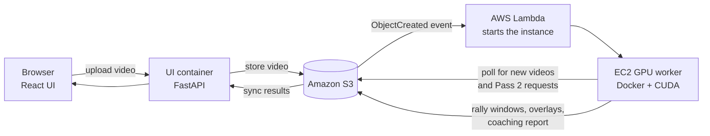

# PickleIQ

PickleIQ turns fixed-camera pickleball match video into segmented rallies and
per-player coaching feedback, for recreational players and the clubs that film
their courts.

> **Screenshot placeholder.** Add `docs/images/results.png` (the Results screen:
> per-player feedback on the left, the video with player overlays and the
> timestamped tip list on the right) and replace this note with
> ``.

## Key results

- Used by a pickleball club with more than 200 members.
- **68x more ball-detection coverage** after fine-tuning TrackNetV2 on about 600
  hand-labeled frames. On a 7,413-frame test clip, the ball was found in 34% of
  frames (2,525), up from about 0.5% with the classical motion detector.
- **85% faster rally segmentation.**
- **Far-side player recall from 35% to 100%** by running pose estimation at
  1920 px instead of 1280 px (74 ms per frame instead of 43).

## How it works



1. **Upload.** The browser sends the video to a lightweight FastAPI container
   (`RUN_PROCESSING=0`), which stores it in S3. That container never runs
   computer vision; it uploads, displays, and syncs results.
2. **Wake the worker.** An S3 event triggers a Lambda function that starts the
   EC2 GPU instance. The Lambda only powers the instance on. Once running, the
   worker's `cloud_ingest` thread polls S3 for videos it has not processed yet.
3. **Pass 1: find candidate rallies.** The worker scans the whole clip at low
   resolution and every third frame. A rally is live while a fast, ball-sized blob
   keeps crossing the net, projected through a court homography. Windows are
   padded and merged to favour recall.
4. **Review.** The user keeps or skips each candidate and can mark rallies Pass 1
   missed. The selections go back to the worker through S3.
5. **Pass 2: precise detection.** Only inside the selected windows, at full frame
   rate: YOLO11-pose with ByteTrack for players, a colour and court-position
   re-identification layer that keeps player numbers stable across the match, and
   a ball pipeline (fine-tuned TrackNetV2, a motion-based trajectory selector,
   RANSAC arc fitting, Kalman smoothing, and 3D height reconstruction).
6. **Coaching.** Wrist-speed peaks mark contacts. Per-frame form and positioning
   metrics are scored against thresholds, the most salient moments are selected,
   and one Claude API call turns them, with a keyframe image for each, into
   timestamped tips and per-player feedback. Timestamps and player attribution
   always come from the pipeline's own data, never from the model.
7. **Results.** The UI plays the original video with dead time skipped and tips
   linked to their timestamps. The video is never re-encoded.

When idle, the worker stops itself (`self_stop.py`), with grace periods so the
user's review step does not force a cold start. For details, see
[`docs/pipeline-overview.md`](docs/pipeline-overview.md).

## Tech stack

| Area | Technology |
|---|---|
| Backend | Python 3.12, FastAPI, SQLite |
| Computer vision | OpenCV, PyTorch, Ultralytics YOLO11-pose, ByteTrack, TrackNetV2, OpenVINO (Intel GPUs) |
| Modelling | NumPy, SciPy, XGBoost (optional rally classifier) |
| Coaching | Anthropic Claude API |
| Frontend | React 18, Vite 5 |
| Infrastructure | Docker (CUDA 12.6), AWS S3, Lambda, EC2, ECR, Secrets Manager |

## Repository layout

```
backend/
  app/
    api/            FastAPI routers
    cv/             Pass 1 and Pass 2, player tracking and identity, ball tracking
    refine/         Advisory rally keep/trim classifier that runs after Pass 2
    rallyanalysis/  Contact detection, form and positioning metrics, coaching report
    learning/       Versioned tunable parameters and model registry
    analysis/       Comparison against human labels, discrepancy report
  scripts/          Training and evaluation CLIs (TrackNet fine-tuning, eval harnesses)
frontend/
  src/pickleiq/     Consumer flow: upload, review, progress, results
  src/              Internal testing UI (labelling, calibration, overlays)
  scripts/          Node check for the processing adapter
deploy/             Build, push, and restart scripts for the ECR image and EC2 worker
docs/               Pipeline, detection, and rally-boundary design docs
reference_data/     Hand-labelled ball and rally ground truth used by the eval scripts
Dockerfile          GPU worker image
```

## Running locally

Prerequisites: Python 3.12, Node.js 18 or later. A GPU is optional; without one,
inference runs on the CPU.

```powershell
git clone https://github.com/rohannuthi7/CV-Training-Tool.git
cd CV-Training-Tool

py -3.12 -m venv backend\.venv
backend\.venv\Scripts\pip install -r backend\requirements.txt
npm install
npm --prefix frontend install

copy .env.example .env    # optional: set ANTHROPIC_API_KEY for coaching reports
npm run dev               # backend on :8420, frontend on http://localhost:5173
```

`npm run dev` is Windows-only (it frees the two ports with PowerShell first). On
macOS or Linux, run the two servers directly:

```bash
python3.12 -m venv backend/.venv
backend/.venv/bin/pip install -r backend/requirements.txt
npm --prefix frontend install
(cd backend && .venv/bin/python -m uvicorn app.main:app --port 8420 --reload) &
npm --prefix frontend run dev
```

Pass 2 needs a court calibration: open the **Testing** tab, pause on a frame,
and use "Auto-detect corners" or click at least four reference points. It is saved
and reused for every clip from the same camera setup.

**Environment variables** (all optional locally; see [`.env.example`](.env.example)):
`ANTHROPIC_API_KEY`, `ANTHROPIC_COACHING_MODEL`, `ANTHROPIC_REPORT_MODEL`,
`CV_DEVICE`, `HW_PROFILE`, `POSE_MODEL`, `TRACKNET_ENABLED`, `TRACKNET_WEIGHTS`,
`PASS2_BALL`, `DATA_DIR`, `STORAGE_BACKEND`, `S3_VIDEO_BUCKET`, `AWS_REGION`,
`RUN_PROCESSING`.

**Tests:**

```powershell
cd backend
.venv\Scripts\python -m pytest
```

## Limitations and next steps

- **Ball tracking is the accuracy ceiling.** The far-baseline ball is a few
  pixels wide, so its reconstructed height is unreliable there. Contact detection
  uses pose only for this reason.
- **No paddle tracking.** Paddle position and face angle are not measured, so much
  of what a coach looks at in a stroke is invisible to the system.
- **Form is judged at single frames** (knee bend, elbow extension). Swing
  preparation, sequencing, and follow-through are not measured yet.
- **Positioning ignores the ball and the opponent.** Target zones are fixed court
  geometry.
- **The refine stage is advisory.** Its keep/trim decisions are written to JSON for
  review and are not yet promoted to rally boundaries. A trained rally-end model
  exists but is not loaded.
- **Known bug:** the `tip_feedback` table was dropped from the schema while code
  still uses it, so a fresh database fails when tip feedback is read or written.
  This is the one failing test.
- **Single tenant.** S3 keys use a placeholder user id; there is no
  authentication or multi-user separation.
- **Infrastructure is partly outside the repo.** The Lambda function, S3 event
  notification, and IAM roles were set up in the AWS console and are not defined
  here.

## Contributors

Built by [Rohan Nuthi](https://github.com/rohannuthi7) and
[Aadhitya Balaji](https://github.com/aadhibalaji).

## License

[MIT](LICENSE). The bundled `yolo11n-pose.pt` weights and the Ultralytics library
are licensed separately under AGPL-3.0.
