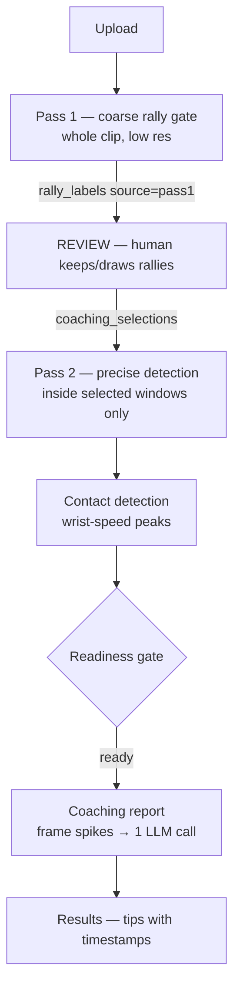

# Pipeline overview

How a clip travels from upload to coaching feedback: what Pass 1 does, what the
human does in Review, what Pass 2 does, and how the coaching report is built.

This is the end-to-end map. Two companion docs go deeper on their own areas:

| Doc | Covers |
|---|---|
| [`detection-spec.md`](detection-spec.md) | Detection internals, thresholds, learnable parameters |
| [`rally-boundaries.md`](rally-boundaries.md) | Rally start/end decisions and the refine keep/drop stage |

Both were last checked against the code on 2026-07-20, before the Review stage
and the coaching redesign described here existed. This document was last checked
on 2026-08-08.

---

## 1. The whole journey



The consumer UI ([`PickleIQApp.jsx:28`](../frontend/src/pickleiq/PickleIQApp.jsx#L28)) is a
single `stage` string: `upload → pass1 → review → pass2 → analysis → results`.

**The key structural fact:** Pass 2 no longer auto-chains after Pass 1
([`pipeline.py:553-560`](../backend/app/pipeline.py#L553-L560)). A human decides which
rallies are worth the expensive pass. That human gate is the Review stage, and it
is the reason the two passes can afford to be so different.

---

## 2. Pass 1: the coarse gate

**Job:** scan 100% of the footage cheaply and answer only *"is a rally roughly
happening here?"* It favours recall — generous, padded windows — because Review
and Pass 2 can discard a false positive, but nothing downstream can recover a
rally Pass 1 never emitted.

**Runs automatically on upload** ([`media.py:88-91`](../backend/app/api/media.py#L88-L91)
→ `pipeline.start_processing`).

### Tools

| Signal | Tool | Notes |
|---|---|---|
| Motion energy | OpenCV `absdiff`, court-ROI masked | No ML ([`pass1.py:52-61`](../backend/app/cv/pass1.py#L52-L61)) |
| Ball blobs | `MotionBallDetector` — 3-frame differencing, area/circularity | Classical, **not** TrackNet ([`ball_coarse.py:49`](../backend/app/cv/ball_coarse.py#L49)) |
| Net crossings | Blob → court coords via homography, side of `NET_Y` | The primary gate signal |
| Pose spot checks | YOLO11-pose every ~2.0 s, full-res, `imgsz=1280` | `track_sequence=False` — **no ByteTrack in Pass 1** |

Decoded at `p1_frame_step=3`, `p1_scale=0.4` — roughly a third of the frames at
40% resolution ([`params.py:17-18`](../backend/app/learning/params.py#L17-L18)).

### How it decides a rally

Calibrated clips gate on **net-crossing recency**: live while a crossing occurred
within `p1_cross_window_s` (2.0 s). Uncalibrated clips fall back to motion above an
EMA baseline **plus** a recent fast blob ([`pass1.py:344-349`](../backend/app/cv/pass1.py#L344-L349)).

That choice is measured, not aesthetic: a motion-only gate scored **mean IoU 0.05
vs 0.52** for the crossing gate ([`pass1.py:171-174`](../backend/app/cv/pass1.py#L171-L174)).
Neighbouring courts and players bouncing balls between points defeat raw motion.

Then hysteresis (on 0.7 s / off 2.0 s), drop if shorter than `p1_min_rally_s` (2.0 s),
**pad the start** by 1.5 s, **tighten the end** to the last sustained crossing +0.6 s,
and merge windows closer than 0.5 s ([`pass1.py:206-257`](../backend/app/cv/pass1.py#L206-L257)).

### Output

- `rally_labels` rows, `source='pass1'` — one row per window, the unit everything
  downstream consumes.
- `overlays` (source `pass1`), 900-frame JSON chunks: `f`, `me` motion energy, `mt`
  threshold, optional `ball`, `cross`, and on spot-check frames `sf` (serve
  formation) + sparse `players[]`.

### Deliberately not doing

No dense ball tracking, no per-frame pose, no stable player IDs, no bounce/hit
events. Known limit: the wide crossing window can bridge two adjacent rallies into
one window — an accepted trade-off, and part of why Review exists.

---

## 3. Review: the human gate

**The cheapest accuracy in the system.** Rather than making Pass 1 smart enough to
be right, the user confirms it in seconds.

In [`RallyReviewScreen.jsx`](../frontend/src/pickleiq/RallyReviewScreen.jsx) the user:
1. **Keeps or skips** each Pass 1 candidate, one at a time, with the video
   auto-seeking to each candidate's start.
2. Optionally **draws their own** ranges (Mark start / Mark end) for rallies Pass 1
   missed or mis-bounded.

Both become `coaching_selections` rows ([`db.py:188-199`](../backend/app/db.py#L188-L199)):

| Column | Values |
|---|---|
| `source` | `pass1_accepted` (copied from a `rally_labels` row) · `user_drawn` (manual frames) |
| `status` | `pending → processing → ready` \| `failed` |

`POST /process-selections` ([`rally_analysis.py:421-478`](../backend/app/api/rally_analysis.py#L421-L478))
then does one subtle but important thing: for each **user-drawn** selection it
backfills a `rally_labels` row with `meta.user_drawn=true`. Readiness, contact
detection and coaching are all keyed on `rally_labels`, so without that backfill a
hand-drawn rally would be invisible to everything downstream. The flag also lets
refine's keep/drop skip it — a human-drawn rally shouldn't be second-guessed.

It then submits **one** Pass 2 job scoped to exactly those windows
(`_build_do_pass2_selections`), or hands the payload to EC2 via S3 when
`RUN_PROCESSING=0`.

---

## 4. Pass 2: precise detection

**Job:** produce an accurate per-frame player (and optionally ball) overlay
*inside the selected windows only* — roughly 20% of the clip, at full frame rate
and near-full resolution.

**Requires court calibration.** It raises without a homography
([`pass2.py:126-129`](../backend/app/cv/pass2.py#L126-L129)).

### Detection-only pivot (verified)

Pass 2 **does not decide rally boundaries**. `rally_logic` is not even imported;
`run_pass2` returns `[]` and actively deletes stale `rally_labels` rows for its own
source ([`pass2.py:198-200`](../backend/app/cv/pass2.py#L198-L200)). Pass 1 + Review are
the sole boundary authority. `cv/rally_logic.py` (~380 lines) remains in the tree,
dead but revivable.

### Tools

- **YOLO11-pose + ByteTrack** for tracked player identity. The tracker config is
  passed as an absolute `bytetrack.yaml` path — the bare filename cost ~29% of Pass 2
  runtime ([`players.py:31-36`](../backend/app/cv/players.py#L31-L36)).
- **Device selection.** On the EC2 worker, pose runs through PyTorch on CUDA
  (`CV_DEVICE=cuda`). On Intel Arc machines, Ultralytics cannot drive
  `device='xpu'`, so the pose model is exported to OpenVINO (`device="intel:gpu"`)
  and cached per `(imgsz, precision)`; the CPU fallback is about 6× slower.
- **`pose_imgsz=1920`**, chosen from measured far-player recall:

  | imgsz | far-player recall | ms/frame |
  |---|---|---|
  | 1280 | 35% | 43 |
  | 1536 | 87% | 55 |
  | **1920** | **100%** | 74 |

- **Player identity** ([`identity.py`](../backend/app/cv/identity.py)): persistent per-team
  slots matched on court distance + HSV torso histogram + dominant hue, with sticky
  hysteresis and an ambiguity flag. This is what keeps "Player 2" the same human all
  match, rather than following a ByteTrack id that renumbers on every dropout.
  Shirt numbers are assigned **only at serve frames** (left→right: near 1,2 / far 3,4).
- **Ball** (chain: manual correction → external track → TrackNet → classical) with a
  motion-primary trajectory selector, velocity gate, arc RANSAC, Kalman smoothing,
  and hit/bounce classification. External trackers can POST to `/videos/{id}/ball_track`.

> **Note:** Pass 2 ball detection is off by default (`PASS2_BALL_ENABLED = False`
> in [`config.py`](../backend/app/config.py), about 11% of Pass 2 cost). Set
> `PASS2_BALL=1`, or use a hardware profile that enables it, to turn it on.

### Output

`overlays` (source `pass2`), one entry per frame:

```json
{"f": 1234,
 "players": [{"id": 1, "num": 2, "box": [x1,y1,x2,y2], "cxy": [court_x, court_y],
              "team": "near", "kp": [[x,y] × 17], "kp_conf": [17], "id_ambiguous": false}],
 "pspeed": 1.8,
 "ball": [x, y, diameter, conf], "world": [court_x, court_y, height_m], "evt": {...}}
```

`kp` is COCO-17 keypoints; `cxy`/`world` are court **metres** from the homography.
Height comes from apparent-ball-size depth reconstruction, and degrades honestly:
σ ≈ 0.12 m near the camera but **≈0.57 m at the far baseline**, where height is set
`NaN` rather than guessed.

### Refine: active but advisory

[`backend/app/refine/`](../backend/app/refine/) scores each window (tracking → P(live)
classifier, XGBoost when importable → smoothing → serve gate) into
`rally`/`rejected` verdicts. It writes **`data/refine/<id>.json` only — never
`rally_labels`** ([`pipeline.py:313-316`](../backend/app/pipeline.py#L313-L316)). It informs
the keep/drop UI; it does not move boundaries.

---

## 5. Pass 1 vs Pass 2

| | **Pass 1** | **Pass 2** |
|---|---|---|
| **Question** | Is a rally roughly here? | Exactly what happened here? |
| **Coverage** | 100% of clip | Only selected windows (~20%) |
| **Frames** | Every 3rd | Every frame |
| **Scale** | 0.4× | Full res, pose at 1920 |
| **Pose** | Spot check ~2 s, `imgsz=1280` | Every frame + ByteTrack |
| **Player IDs** | None (stale boxes) | Stable slots + shirt numbers |
| **Ball** | Coarse blobs (gate signal) | Full chain, arcs, bounce/hit, 3D height |
| **Calibration** | Optional (fallback gate) | **Required** |
| **Writes rally_labels** | Yes (sole authority) | Never |
| **Trigger** | Automatic on upload | User-triggered via Review |
| **Bias** | Recall — over-emit | Precision |

---

## 6. Contacts and the readiness gate

**Contact detection** ([`contact_detect.py`](../backend/app/rallyanalysis/contact_detect.py))
runs as its own chained job after Pass 2. It is **pose-only and never uses the
ball** — a deliberate choice, because ball tracking is the system's least reliable
signal. It finds wrist-speed peaks above `median + 3.5·MAD` (floor 40 px/s), NMS at
0.35 s, and writes `contact_events` rows.

**Readiness** ([`readiness.py`](../backend/app/rallyanalysis/readiness.py)) decides which
rallies coaching may use. `get_analyzable_rallies` returns only rallies whose Pass 2
overlay actually covers them (±15 frames). Blocking reasons: `pass2_not_done`,
`pass2_running`, `overlay_stale`. Exclusion is all-or-nothing per rally — a partially
covered rally is dropped rather than half-analysed.

---

## 7. Coaching report: spikes to tips

Since the **2026-08-05 redesign**, detection is **continuous per-frame**, not
per-shot. This matters: the older per-shot code (`compute_feature_vector`,
`positioning.build_vectors`) still exists but **is no longer on the live path**.

```
_build_vectors_meta
  → frame_metrics.build_frame_series   per-frame {values, devs} per player
  → frame_metrics.detect_spikes        runs where a metric clears its OWN threshold
  → _spike_contact / _spike_vector     span pseudo-contact "spk_<rally>_<pid>_<metric>_<frame>"
  → select_tip_candidates              salience rank, category caps, ≤2 praise
  → keyframes.extract_for_candidates   JPEGs for selected moments only
  → ONE Anthropic call
  → CoachingReport
```

**What's actually scored today** (the live metric set is small — see
[`frame_metrics.py:144-163`](../backend/app/rallyanalysis/frame_metrics.py#L144-L163)):

- **Form:** `knee_bend_deg` (continuous), `elbow_extension_deg` (contact-anchored).
- **Positioning:** `kitchen_distance_m`, `transition_zone_occupancy`,
  `lateral_offset_m` (singles), `partner_depth_stagger_m` (doubles).

Serve swing windows are excluded from the series entirely, so serve technique never
pollutes a rally-play average.

**The LLM call** ([`coaching.py:1462-1585`](../backend/app/rallyanalysis/coaching.py#L1462-L1585)):
exactly one per report, `claude-sonnet-5`, streamed, adaptive thinking, JSON-schema
output at `effort: high`. It receives the candidate moments as JSON **plus a base64
JPEG keyframe per moment** — vision is primary evidence, the numbers corroborate.
Returns `{contact_id: {tip, tone}}` and per-player general feedback, capped at
`MAX_TIPS=8`.

Two safeguards worth knowing: timestamps, frames and player attribution always come
from our own data (never the model's), and unrecognized ids are dropped. Every
failure mode degrades to an empty report rather than a fabricated one.

---

## 8. What the user sees

[`ResultsScreen.jsx`](../frontend/src/pickleiq/ResultsScreen.jsx): per-player general
feedback on the left, video + timestamped tip list on the right. Clicking a tip
seeks the video.

**Rally-only playback is not a re-encode.** `buildRallySegments` produces skip
segments and the player jumps over dead time on `timeupdate`
([`processingAdapter.js:432`](../frontend/src/pickleiq/processingAdapter.js#L432)). The
source video is never cut — so every tip timestamp stays valid on the original
timeline. The same mechanism now runs on the Pass 2 screen.

---

## 9. The two feedback loops

They are often confused. They measure different things:

| | **tip_feedback** | **coaching_marks** |
|---|---|---|
| Rates | The *tip copy* | The *play itself* |
| Shape | 1 thumb per surfaced tip | verdict `bad`/`fine`/`good` over a frame span |
| Covers | Only moments the LLM chose | Any moment, including ones nothing flagged |
| Gives | Selection-quality hit rate | Precision **and recall** |
| Used by | Light LLM tiebreaker | Threshold calibration |

`coaching_marks` exists because `tip_feedback` structurally cannot say whether a
moment the detector *missed* was bad. Only freeform marks yield recall — see
[`label_eval.py`](../backend/app/rallyanalysis/label_eval.py),
`backend/scripts/eval_coaching.py`, and the supervised sweep in
[`calibrate_thresholds.py`](../backend/app/rallyanalysis/calibrate_thresholds.py).

Without labels, `calibrate_thresholds.py` falls back to percentiles — which flag a
fixed ~10% of frames *by construction*, whether or not anything is wrong. That is a
starting point for collecting labels, never a validated answer.

---

## 10. Known gaps

- **`tip_feedback` table is missing from the schema.** `db.py` no longer contains
  its `CREATE TABLE`, but [`rally_analysis.py`](../backend/app/api/rally_analysis.py)
  still inserts into it and [`coaching.py`](../backend/app/rallyanalysis/coaching.py)
  still reads it. Databases created before the change still have the table; a fresh
  database fails with `no such table: tip_feedback`.
- **Ball tracking is the accuracy ceiling.** Far-baseline height is unusable; contact
  detection avoids the ball entirely for this reason.
- **Paddle is never tracked.** No paddle position or face angle exists anywhere, so
  a large part of human form judgment is structurally invisible.
- **Form is judged near-instantaneously** — knee and elbow angles at a frame. Swing
  preparation, sequencing and follow-through are not measured.
- **Positioning ignores the ball and the opponent.** Bands are fixed court geometry;
  nothing conditions "correct position" on where the ball actually is.
- **The two companion docs predate this one** (checked 2026-07-20) and describe
  crossing detection and end-trimming slightly differently from current `pass1.py`.

---

## 11. File map

| Area | Path |
|---|---|
| Orchestration | `backend/app/pipeline.py`, `backend/app/jobs.py` |
| Pass 1 | `backend/app/cv/pass1.py`, `ball_coarse.py` |
| Pass 2 | `backend/app/cv/pass2.py`, `players.py`, `identity.py` |
| Ball | `ball_track.py`, `ball_filter.py`, `bounce.py`, `kalman.py` |
| Court | `backend/app/cv/court.py` |
| Refine | `backend/app/refine/` |
| Coaching | `backend/app/rallyanalysis/` (`coaching.py`, `frame_metrics.py`, `contact_detect.py`, `readiness.py`) |
| Ground truth | `label_eval.py`, `calibrate_thresholds.py`, `backend/scripts/eval_coaching.py` |
| Consumer UI | `frontend/src/pickleiq/` |
| Testing UI | `frontend/src/Workspace.jsx`, `frontend/src/RallyAnalysis/` |
